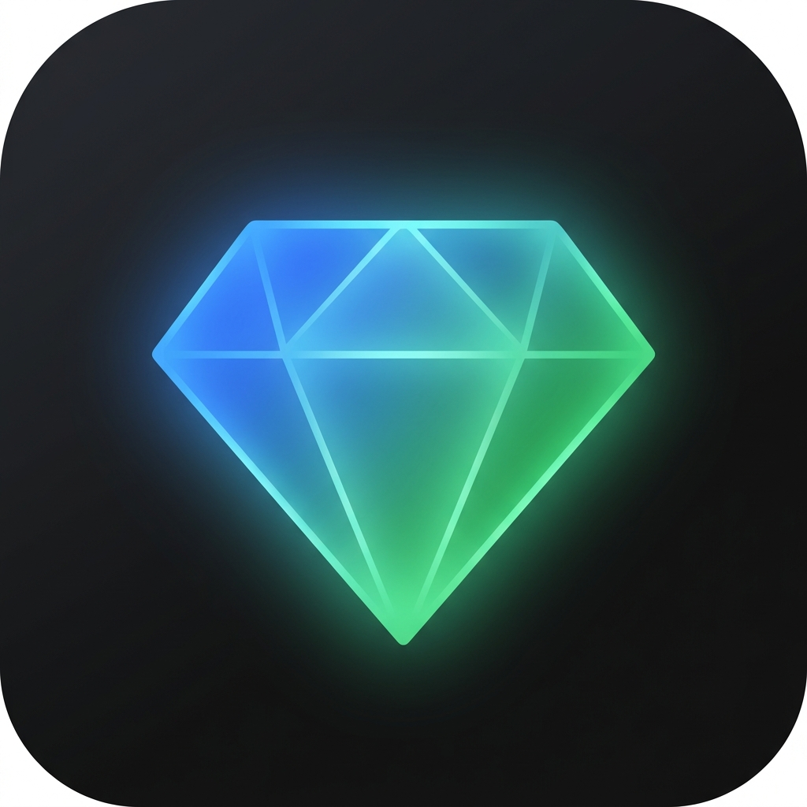

# Ultralay — Gemini AI Stealth Overlay

<div align="center">



**A transparent, always-on-top AI overlay powered by Google Gemini.**  
**Capture any screen, ask anything — invisible to screen recorders.**

[](https://github.com/Himanshutomar03/ultralay/releases/latest)
[](https://github.com/Himanshutomar03/ultralay/releases)
[](LICENSE)

</div>

---

## ✨ Features

| Feature | Details |
|---|---|
| 🤖 **Gemini AI** | Gemini 3.8 Flash, 2.5 Pro/Flash, 1.5 Pro/Flash — all vision-capable |
| 🔑 **Multi-key rotation** | Add multiple API keys — auto-rotates when one hits quota |
| 📸 **SEB-proof screenshot** | Uses Win32 `PrintWindow(PW_RENDERFULLCONTENT)` — captures even protected/exam windows |
| 🎥 **Hidden from screen share** | `WDA_EXCLUDEFROMCAPTURE` via koffi FFI — invisible to OBS, Meet, Teams, Zoom |
| 👻 **Click-through stealth** | `WS_EX_TRANSPARENT` — clicks pass to whatever is under the overlay |
| ⚡ **Zero-latency** | Direct Win32 FFI via `koffi` — no PowerShell, no delay |
| 🔄 **Always on top** | 30ms watchdog re-asserts topmost — survives SEB's own raise-watchdog |
| 📌 **Hover to interact** | Invisible in passthrough mode, activates when you hover |

---

## 🚀 Quick Start (Portable — No Install)

1. Download **`Ultralay-v2.0.0-portable.exe`** from [Releases](https://github.com/Himanshutomar03/ultralay/releases/latest)
2. Run it — no install needed
3. Open **⚙ Settings** and paste your [Gemini API key](https://aistudio.google.com/app/apikey)
4. Press **`Ctrl+Alt+S`** to screenshot → type your question → send

---

## ⌨️ Hotkeys

| Key | Action |
|---|---|
| `Alt+\`` | Hide / Show overlay |
| `Ctrl+Alt+S` | Screenshot & attach |
| `Ctrl+Alt+L` | Lock interactive mode |
| `Ctrl+Shift+P` | Open Settings |
| `Ctrl+Alt+Q` | Quit |

---

## 🔑 Multi-Key Setup

Go to **Settings → Gemini API Keys** and add as many keys as you want.  
When Key 1 hits quota, it automatically switches to Key 2, then Key 3, etc.  
Exhausted keys show in 🔴 red, active key shows in 🟢 green.

Get free API keys at → **[aistudio.google.com](https://aistudio.google.com/app/apikey)**

---

## 🛡️ Stealth Modes

| Mode | Badge | Behaviour |
|---|---|---|
| **PASSTHROUGH** | 🟢 green | Default — clicks go through to app below |
| **INTERACTIVE** | 🟡 yellow | Mouse is hovering — overlay receives input |
| **LOCKED** | 🔴 red | `Ctrl+Alt+L` — stays interactive |

### Screen Share Protection
Enable **"Hidden from screen share"** in Settings to become completely invisible to:
- OBS Studio
- Google Meet / Zoom / Teams screenshare  
- Safe Exam Browser (SEB) screen monitoring
- Any capture tool using Windows graphics APIs

---

## 🔨 Build from Source

```bash
git clone https://github.com/Himanshutomar03/ultralay.git
cd ultralay
npm install
npm start          # run in dev
npm run build      # build portable .exe → dist/
```

Requires **Node.js 18+** and **Windows 10+**.

---

## 📄 License

MIT © 2026 [Himanshutomar03](https://github.com/Himanshutomar03)
